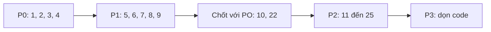

# FE cần sửa gì cho luồng đặt lịch

> [!NOTE]
> Rà soát FE-Web và Mobile, đối chiếu với backend hiện tại. Sắp xếp theo mức ưu tiên: 🔴 lỗi chặn luồng, 🟠 sai nghiệp vụ, 🟡 UX/tối ưu, ⚪ dọn code.

## 🔴 P0: Lỗi làm hỏng luồng

### 1. Form walk-in tại quầy không gửi `doctorId`, nên luôn lỗi
[ReceptionWalkinBookingForm.tsx L173-L181](file:///d:/Kì%209/FE-Web/src/modules/reception/ReceptionWalkinBookingForm.tsx#L173-L181)
- Form gọi `issue`, `call('01')`, rồi `done({ patientId, reasonForVisit, priority })` mà **không có `doctorId`**. Backend `done()` bắt buộc có bác sĩ với walk-in, nên trả lỗi *"Lịch hẹn này chưa gán bác sĩ"*.
- Hậu quả: mỗi lần bấm thất bại lại để lại **1 ticket mồ côi ở trạng thái `called`** trong hàng đợi.
- Form còn **chen ngang hàng đợi** (tự `call` ngay) và gán cứng quầy `'01'`.
- **Sửa**: thêm ô chọn bác sĩ (chỉ hiện bác sĩ đang trong ca). Nên **bỏ hẳn form này** và dồn về một luồng chuẩn: bốc số → gọi số → [ReceptionIntakeModal](file:///d:/Kì%209/FE-Web/src/modules/reception/components/ReceptionIntakeModal.tsx), vì modal đó đã xử lý đủ 3 trường hợp. Nếu vẫn giữ thì cần có xử lý khôi phục khi `call` hoặc `done` lỗi.

### 2. Ô tìm kiếm danh sách lịch hẹn bị crash khi lịch có số thứ tự
[ReceptionAppointmentsView.tsx L166](file:///d:/Kì%209/FE-Web/src/modules/reception/ReceptionAppointmentsView.tsx#L166)
- Code gọi `app.queueTicket?.ticketNumber?.toLowerCase()`, nhưng `ticketNumber` trong DB là **Int**. Type FE khai báo sai là `string` ([appointment.service.ts L164](file:///d:/Kì%209/FE-Web/src/services/appointment/appointment.service.ts#L164)), nên gõ tìm kiếm sẽ gây `TypeError`.
- **Sửa**: đổi type thành `ticketNumber: number; ticketPrefix: 'A' | 'B'`, rồi tìm theo mã đã format (`A005`).

### 3. Gọi API không tồn tại
[appointment.service.ts L346-L361](file:///d:/Kì%209/FE-Web/src/services/appointment/appointment.service.ts#L346-L361): `createAtHospitalAppointment()` gọi `POST /appointments/at-hospital` (sẽ 404). Hàm này không còn chỗ nào dùng, **xóa đi**.

### 4. Hiển thị số thứ tự sai ở trang bệnh nhân
[AppointmentDetailModal.tsx L352-L355](file:///d:/Kì%209/FE-Web/src/modules/patient/components/AppointmentDetailModal.tsx#L352-L355)
- Chỉ hiện số trần, không có prefix (`5` thay vì `A005`).
- Dùng `queueTicket.queueStatus`, nhưng backend trả về `status`, nên luôn hiện `undefined`.
- **Sửa**: tạo helper dùng chung `formatTicketCode(t)` (đang bị copy ở 3 file) và đổi sang dùng `status`.

---

## 🟠 P1: Sai nghiệp vụ / bảo mật

### 5. FE tự đánh dấu "đã xác minh danh tính" và tự tạo consent
[ReceptionQueueCallingWorkspaceView.tsx L484-L509](file:///d:/Kì%209/FE-Web/src/modules/reception/ReceptionQueueCallingWorkspaceView.tsx#L484-L509)
- Khi không có `intakeData` (thu tiền từ màn khác, F5 trang…), FE **tự ghi** `verificationStatus: 'verified'`, consent mặc định và lý do khám "Khám bệnh". Như vậy là **vô hiệu hóa** bước kiểm tra của `completeRegistration`.
- Các lỗi của từng bước đều bị nuốt bằng `console.warn`.
- **Sửa**: bỏ phần fallback giả lập. Nếu thiếu dữ liệu thì mở lại modal tiếp đón để lễ tân nhập. Hiện đúng danh sách `missing[]` mà backend trả về.

### 6. Đặt lịch online: đang lấy hồ sơ người khác làm fallback
[PatientBookingForm.tsx L74-L99](file:///d:/Kì%209/FE-Web/src/modules/patient/components/PatientBookingForm.tsx#L74-L99)
- Khi `getMyPatients()` lỗi hoặc rỗng, FE gọi `getAllPatients()`, nên bệnh nhân có thể thấy hồ sơ của người khác. Backend sẽ chặn bằng 403 nhưng dữ liệu đã bị lộ.
- **Sửa**: chỉ dùng `getMyPatients()`. Nếu rỗng thì hiện CTA "Tạo hồ sơ".

### 7. Chọn "Khám VIP" thì tự gán `priority = 'urgent'`
Xảy ra ở cả 3 nơi: [PatientBookingForm L190](file:///d:/Kì%209/FE-Web/src/modules/patient/components/PatientBookingForm.tsx#L190), [BookingForm L187](file:///d:/Kì%209/FE-Web/src/components/home/BookingForm.tsx#L187), Mobile `appointments.tsx L327`.
- `urgent` là **mức ưu tiên y tế** (được đẩy lên đầu nhóm trong hàng đợi). Để bệnh nhân tự chọn là sai nghiệp vụ, ai trả VIP cũng chen lên trước.
- **Sửa**: FE đặt lịch online **không gửi `priority`**. Mức ưu tiên do lễ tân/điều dưỡng đánh giá. VIP nên là trường hoặc loại dịch vụ riêng, không nhét `[Khám VIP]` vào `reasonForVisit`.

### 8. Cho check-in lịch không phải của hôm nay
[ReceptionAppointmentsView.tsx L851](file:///d:/Kì%209/FE-Web/src/modules/reception/ReceptionAppointmentsView.tsx#L851) và [ReceptionIntakeModal L251-L253](file:///d:/Kì%209/FE-Web/src/modules/reception/components/ReceptionIntakeModal.tsx#L251-L253)
- Nút Check-in hiện với **mọi** lịch `confirmed`, kể cả lịch tuần sau. Backend phát số theo **ngày hôm nay**, nên bệnh nhân hẹn tuần sau sẽ vào hàng đợi hôm nay.
- Modal tiếp đón số B cũng liệt kê lịch online `pending/confirmed` của mọi ngày.
- **Sửa**: chỉ hiện Check-in hoặc cho chọn khi `appointmentDate` là hôm nay. Ngày khác thì disable kèm tooltip (backend cũng nên chặn).

### 9. Lịch khách vãng lai "khớp hồ sơ" chưa đối chiếu vẫn đi tiếp được
[ReceptionIntakeModal L419-L423](file:///d:/Kì%209/FE-Web/src/modules/reception/components/ReceptionIntakeModal.tsx#L419-L423): khi chọn lịch online có `patientId = null` và `suggestedPatientId` khác null, bấm tiếp nhận sẽ bị backend báo lỗi *sync-patient*.
**Sửa**: phát hiện trường hợp này ngay khi chọn lịch, rồi mở luôn `SyncPatientModal` ngay trong modal tiếp đón.

### 10. Bắt đối chiếu CCCD trước khi được "Xác nhận"
[ReceptionAppointmentsView L816-L851](file:///d:/Kì%209/FE-Web/src/modules/reception/ReceptionAppointmentsView.tsx#L816-L851): hồ sơ `draft` hoặc trường hợp "khớp" thì nút Xác nhận bị thay bằng "Xác thực HS" / "Đối chiếu CCCD". Hai việc này cần **cầm giấy tờ thật**, nên lễ tân không thể xác nhận lịch từ xa (gọi điện) trước ngày khám.
**Đề xuất** (cần chốt với PO): cho phép Confirm ngay; chuyển bước đối chiếu CCCD / xác thực hồ sơ sang **lúc check-in**.

---

## 🟡 P2: UX / tối ưu

| # | Vấn đề | Vị trí | Sửa |
|---|---|---|---|
| 11 | Tính ngày bằng `toISOString()` (giờ UTC). Từ 0h-7h sáng giờ VN sẽ lệch 1 ngày (ngày mặc định, `min`) | PatientBookingForm L49-L53, L520; BookingForm L44-L48; Mobile L65, L79 | Dùng helper `getLocalDateString()` (đã có ở QueueCalling) |
| 12 | Vẫn hiện slot **đã qua giờ** trong hôm nay | Cả 2 form đặt lịch + Mobile | Lọc `slotStartTime > now` (backend cũng nên chặn) |
| 13 | Tự chọn sẵn bác sĩ đầu tiên và slot đầu tiên, dễ đặt nhầm | PatientBookingForm L129, L154; BookingForm L89, L135 | Bắt người dùng tự chọn slot |
| 14 | Lỗi 409 "Slot đã đầy" không tải lại slot | `handleSubmit` / `handleVerifyOtpSubmit` | Khi gặp 409 thì gọi lại `getFreeSlots`, bỏ chọn slot, báo người dùng |
| 15 | Form khách vãng lai mặc định ngày sinh `1995-01-01`, dễ tạo hồ sơ draft sai | [BookingForm L58](file:///d:/Kì%209/FE-Web/src/components/home/BookingForm.tsx#L58) | Để trống và bắt buộc nhập |
| 16 | Đã đăng nhập vẫn thấy form khách ở trang chủ, đặt sẽ tạo hồ sơ draft trùng | BookingForm | Nếu đã đăng nhập thì chuyển sang `PatientBookingForm` |
| 17 | Nút "Gửi lại mã" OTP không có đếm ngược; backend giới hạn 5 lần/10 phút | BookingForm ~L603 | Thêm đếm ngược 60s và hiện thời hạn OTP (5 phút) |
| 18 | Danh sách lịch của lễ tân sắp theo `createdAt`, không theo giờ khám | ReceptionAppointmentsView L183-L189 | Xem theo ngày thì sắp theo `appointmentTime` |
| 19 | Tìm kiếm phía client, dù backend đã hỗ trợ `search` | ReceptionAppointmentsView L157 | Truyền `search` (debounce) lên API |
| 20 | Gọi API định kỳ: lịch hẹn 20s, hàng đợi 15s, gọi cả khi tab ẩn | ReceptionAppointmentsView, QueueCalling | Dừng khi `document.hidden`. Về lâu dài chuyển sang WebSocket/SSE |
| 21 | Modal tiếp đón chọn sẵn bác sĩ đầu tiên. Backend chỉ nhận bác sĩ **đang trong ca** | ReceptionIntakeModal L155-L158 | Chỉ liệt kê bác sĩ đang trong ca, không tự chọn |
| 22 | Mức ưu tiên gán cứng `'normal'` khi tiếp nhận. Walk-in cấp cứu không được ưu tiên | ReceptionIntakeModal L415 | Thêm ô chọn mức ưu tiên (normal/urgent/emergency) |
| 23 | Chuỗi bước sau thanh toán (tạo encounter, khai báo, `completeRegistration`) chạy liên tiếp trên FE. Lỗi giữa chừng thì kẹt, không có nút làm tiếp | QueueCalling L573-L603 | Thêm trạng thái "Chờ hoàn tất tiếp đón" kèm nút **Tiếp tục**. Tốt nhất là gộp thành 1 API backend |
| 24 | Bệnh nhân không có UI đổi lịch tái khám (backend đã có `PATCH /:id/reschedule`) | PatientPortalAppointmentsView, Mobile | Thêm nút "Đổi lịch" cho lịch `follow_up` |
| 25 | Trang thành công không hướng dẫn bước tiếp theo theo trạng thái (chờ xác nhận, đến quầy check-in, nhận số A) | PatientBookingForm / BookingForm | Hiện timeline: *Chờ lễ tân xác nhận → Đến quầy check-in → Nhận số A* |

---

## ⚪ P3: Dọn code

- Xóa code thừa: `relationship` được map rồi lại bị bỏ đi ([PatientBookingForm L183-L188](file:///d:/Kì%209/FE-Web/src/modules/patient/components/PatientBookingForm.tsx#L183-L188), [service L216](file:///d:/Kì%209/FE-Web/src/services/appointment/appointment.service.ts#L216)); `departments` / `departmentId` trong BookingForm, WalkinForm và service (backend không dùng khoa).
- Comment sai ở [service L310](file:///d:/Kì%209/FE-Web/src/services/appointment/appointment.service.ts#L310): check-in **không** chuyển sang `checked_in`, chỉ phát số A.
- Nút No-show chỉ hiện với `confirmed`, nhưng backend cho cả `pending` và `checked_in`. Cần thống nhất.
- Gộp logic đặt lịch Web/Mobile (format giờ, lọc slot, map lỗi) vào một module dùng chung.
- Thay các chỗ `queueTicket: any` / `payload: any` bằng type đúng.

---

## Thứ tự làm đề xuất

> [!IMPORTANT]
> Các mục 7, 8, 12 nên **sửa cả backend** (không nhận `priority` từ bệnh nhân, chặn check-in khác ngày, chặn slot đã qua giờ). Chỉ chặn ở FE thì vẫn bị gọi thẳng API để vượt qua.
