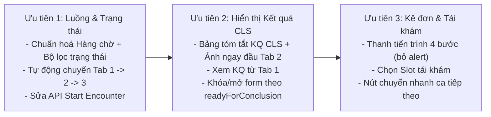

# Đề xuất cải thiện UI/UX Bàn làm việc Bác sĩ (`FE-Web/src/modules/doctor`)

> [!NOTE]
> Đối chiếu trực tiếp 4 giai đoạn trong [luong_kham_chua_benh_bac_si.md](file:///C:/Users/LENOVO/.gemini/antigravity/brain/457a8aeb-62d6-4de0-87e0-d2d0233352c2/luong_kham_chua_benh_bac_si.md) với code hiện tại của [DoctorWorkspaceView.tsx](file:///d:/Kì%209/FE-Web/src/modules/doctor/DoctorWorkspaceView.tsx), [DoctorEMRView.tsx](file:///d:/Kì%209/FE-Web/src/modules/doctor/DoctorEMRView.tsx), [DoctorDiagnosisView.tsx](file:///d:/Kì%209/FE-Web/src/modules/doctor/DoctorDiagnosisView.tsx) và [DoctorPrescriptionView.tsx](file:///d:/Kì%209/FE-Web/src/modules/doctor/DoctorPrescriptionView.tsx).

---

## 1. Các điểm nghẽn lớn nhất khiến bác sĩ "khó thao tác & khó thấy kết quả"

### 🔴 1.1. Hàng chờ bên trái bị nhân bản ở 3 Tab nhưng hiển thị trạng thái khác nhau và không lọc theo bước
- **Hiện trạng**:
  - Cả 3 tab (`Hàng chờ & Hồ sơ`, `Chẩn đoán bệnh`, `Kê đơn thuốc`) đều vẽ lại cột **Hàng chờ bệnh nhân** ở bên trái (4 cột), đồng bộ ca đang chọn qua `localStorage.getItem('doctor_selected_patient_id')` bằng `setInterval(..., 1000)`.
  - Ở Tab 1 ([PatientQueueSidebar.tsx L145-L154](file:///d:/Kì%209/FE-Web/src/modules/doctor/components/PatientQueueSidebar.tsx#L145-L154)), badge chỉ có 2 chữ: **"Đang khám"** hoặc **"Chờ vào"** (thậm chí hễ click chọn `isSelected` là đổi thành "Đang khám" dù chưa bấm bắt đầu!).
  - Ở Tab 2 ([DoctorDiagnosisView.tsx L624-L648](file:///d:/Kì%209/FE-Web/src/modules/doctor/DoctorDiagnosisView.tsx#L624-L648)), mọi ca `in_progress` đều được gắn nhãn xanh **"Đã có KQ CLS"** (`isReady = enc.status === 'awaiting_review' || enc.status === 'in_progress' || enc.status === 'finished'`), dù ca đó vừa mới bắt đầu khám và **chưa hề làm xét nghiệm**!
  - Các ca đã `finished` hoặc thậm chí `arrived` (chưa đo sinh hiệu xong) vẫn lẫn chung trong một danh sách phẳng.
- **Cải thiện**:
  1. **Chia bộ lọc nhanh (Segmented Pills) ngay trên đầu Hàng chờ** theo đúng trạng thái máy của Backend:
     - `Chờ khám` (`waiting_for_doctor`)
     - `Đang khám / Chờ CLS` (`in_progress`, `awaiting_diagnostics`, `diagnostics_in_progress`)
     - `Đã có KQ CLS` (**`awaiting_review`** — nổi bật màu xanh/đỏ để bác sĩ biết ca nào vừa trả kết quả xong cần đọc ngay)
     - `Đã hoàn tất` (`finished`)
  2. **Hiển thị đúng trạng thái thật của `Encounter`**, bỏ logic `isSelected ? 'Đang khám'` và sửa lại `isReady` ở Tab 2 chỉ xanh khi `enc.status === 'awaiting_review'`.

---

### 🔴 1.2. Không tự động chuyển Tab sau khi hoàn thành từng bước (Đứt mạch thao tác)
- **Hiện trạng**:
  - Ở Tab 2 ([DoctorDiagnosisView.tsx L1268](file:///d:/Kì%209/FE-Web/src/modules/doctor/DoctorDiagnosisView.tsx#L1268)), nút bấm ghi rõ: **"Ghi Nhận Kết Luận Chẩn Đoán & Chuyển Kê Đơn (Mô-đun 9)"**, nhưng hàm `handleSaveDiagnosis` ([L480-L508](file:///d:/Kì%209/FE-Web/src/modules/doctor/DoctorDiagnosisView.tsx#L480-L508)) chỉ lưu xong rồi... đứng yên tại chỗ! Bác sĩ phải tự cuộn lên đầu trang, bấm sang Tab 3 (`Kê đơn thuốc & Ký số`).
  - Ở Tab 1, nếu ca bệnh nhẹ **không cần chỉ định CLS**, bác sĩ lưu phiếu khám lâm sàng xong không có nút **"Chuyển sang Kê đơn (Không cần CLS)"** để nhảy thẳng sang Tab 3 (dù Backend cho phép kê đơn trực tiếp từ `in_progress`).
- **Cải thiện**:
  - Truyền callback `onNavigateTab('emr-ai' | 'icd10-diagnosis' | 'prescription')` từ `DoctorWorkspaceView` xuống 3 view con.
  - Khi lưu xong Kết luận & Tư vấn ở Tab 2 → **tự động chuyển sang Tab 3 (Kê đơn)**.
  - Trên Tab 1, thêm nút **"Bỏ qua CLS → Kê đơn ngay"** (khi đã lưu khám lâm sàng + chẩn đoán sơ bộ) và nút **"Xem KQ CLS & Kết luận →"** ngay khi trạng thái ca chuyển sang `awaiting_review`.

---

### 🔴 1.3. Kết quả Cận lâm sàng bị "giấu" trong Timeline chữ nhỏ, thiếu bảng tổng hợp trực quan
- **Hiện trạng**:
  - Khi KTV trả kết quả xét nghiệm máu / ECG / Siêu âm / X-quang, bác sĩ vào Tab 1 (`Khám & Chỉ định CLS` → `TestOrderHistoryList`) chỉ thấy nhãn **"Đã có kết quả"**, **không bấm vào để xem kết quả ngay tại đó được**.
  - Muốn xem kết quả, bác sĩ phải sang Tab 2, nhìn vào cột trái **EMR Timeline** (rộng chỉ 4 cột), tìm sự kiện `Kết quả CLS` rồi bấm nút nhỏ `Xem chi tiết` ([DoctorDiagnosisView.tsx L816-L823](file:///d:/Kì%209/FE-Web/src/modules/doctor/DoctorDiagnosisView.tsx#L816-L823)) để mở Modal.
  - Nếu bệnh nhân làm 4 dịch vụ (Men tim Troponin, ECG, Siêu âm Doppler, X-quang), bác sĩ phải bấm mở/đóng Modal 4 lần, không thể vừa nhìn chỉ số bất thường + ảnh vừa gõ kết luận chẩn đoán ở cột phải.
- **Cải thiện**:
  1. **Đưa thẻ "Tổng hợp Kết quả Cận lâm sàng & Hình ảnh" lên ngay đầu cột phải của Tab 2** (trên khung chọn ICD-10):
     - Tự động gom tất cả `lab_result` từ `timelineData`: hiển thị sẵn các **chỉ số bất thường (tô đỏ)**, kết luận của KTV, và **thumbnail ảnh X-quang / sóng ECG / siêu âm** để bấm phóng to 1 chạm.
  2. **Tại `TestOrderHistoryList` (Tab 1)**: Với hạng mục đã `completed`, thêm nút **"Xem kết quả"** mở ngay modal kết quả hoặc chuyển sang Tab 2.
  3. **Bổ sung nút "Duyệt kết quả (`POST /lab-results/:id/review`)"** và **Xử lý ngoại lệ (`POST /lab-tasks/:id/resolve-exception`)** khi phòng Lab báo sự cố `on_hold` (Backend đã có đủ 2 API này nhưng FE chưa có nút cho bác sĩ).

---

### 🟠 1.4. Lệch API "Bắt đầu khám" và form Chẩn đoán sơ bộ ở Tab 1
- **Hiện trạng**:
  - Nút "Bắt đầu khám" ở `DoctorEMRView` ([L609-L618](file:///d:/Kì%209/FE-Web/src/modules/doctor/DoctorEMRView.tsx#L609-L618)) đang gọi `PATCH /appointments/:id/start`. Nếu ca khám thiếu `appointmentId` trên object rút gọn, nó báo lỗi `alert('Không tìm thấy mã lịch hẹn')`, và quan trọng hơn là **không cập nhật `Encounter.status` (`waiting_for_doctor` → `in_progress`) lẫn `DoctorQueueEntry`**. Trong khi Backend đã có endpoint chuẩn cho bác sĩ là **`POST /doctor-examination/encounters/:encounterId/start`**.
  - Ô "Chẩn đoán sơ bộ" ở Tab 1 đang là text tự do, khi bấm chỉ định CLS mới dùng regex cắt mã ICD-10 hoặc gán cứng `'I20.9'` ([DoctorEMRView.tsx L1145-L1147](file:///d:/Kì%209/FE-Web/src/modules/doctor/DoctorEMRView.tsx#L1145-L1147)), khiến bác sĩ không chọn được đúng mã ICD-10 ban đầu và danh sách chẩn đoán phân biệt (`differential`).
- **Cải thiện**:
  - Đổi `handleStartConsultation` sang gọi `POST /doctor-examination/encounters/:encounterId/start` (kèm `PATCH /appointments/:id/start` nếu cần).
  - Cho phép chọn nhanh ICD-10 (hoặc click 1 chạm từ thẻ **AI Gợi ý chẩn đoán sơ bộ**) để lưu đúng `initialDiagnosis` trước khi tạo chỉ định CLS.

---

### 🟠 1.5. Banner tiến độ CLS ở Tab 2 hiển thị sai thông điệp và cho phép bấm Lưu khi chưa đủ điều kiện
- **Hiện trạng**:
  - Khi sudah hoàn tất CLS (`readyForConclusion = true`), banner ([DoctorDiagnosisView.tsx L918](file:///d:/Kì%209/FE-Web/src/modules/doctor/DoctorDiagnosisView.tsx#L918)) ghi cứng: *"Tất cả 4 dịch vụ Cận lâm sàng Tim mạch (Xét nghiệm men tim, Điện tim ECG, Siêu âm tim Doppler, X-quang) đã có kết quả"*, kể cả khi bác sĩ chỉ chỉ định 1 xét nghiệm máu.
  - Khi `readyForConclusion = false` (`Encounter` chưa ở `awaiting_review`), banner ghi *"Bác sĩ có thể lưu chẩn đoán tạm thời"* và nút Submit vẫn mở. Nhưng Backend (`assertEncounterAwaitingReview`) **chặn cứng chỉ cho lưu khi `status === 'awaiting_review'`**, nên bác sĩ gõ hết form rồi bấm Lưu sẽ bị văng lỗi 400!
- **Cải thiện**:
  - Hiển thị đúng tên và số lượng các dịch vụ thực tế đã chỉ định trong ca đó.
  - Khi `Encounter` đang chờ CLS (`awaiting_diagnostics` / `diagnostics_in_progress`), khoá nút "Ghi nhận kết luận chính thức" (hoặc hiển thị rõ tiến độ từng phòng Lab đang làm đến đâu) để bác sĩ không nhập công cốc.

---

### 🟡 1.6. Trải nghiệm Kê đơn, Ký số & Đóng ca khám (Tab 3)
- **Hiện trạng**:
  - Đã kết nối đầy đủ API thật (`POST /prescriptions`, Safety Check, Override cảnh báo, Ký số CA, Xuất PDF, Đặt tái khám, Kết thúc ca).
  - Tuy nhiên toàn bộ thông báo thành công/lỗi đang dùng `window.alert(...)` ([DoctorPrescriptionView.tsx L574, L610, L737, L756](file:///d:/Kì%209/FE-Web/src/modules/doctor/DoctorPrescriptionView.tsx#L574)) làm ngắt quãng thao tác.
  - Khi đặt lịch tái khám (`POST /prescriptions/:id/followup`), UI mới chỉ cho chọn **Ngày tái khám** (`followUpDate`), chưa hiển thị danh sách **Khung giờ trống (`slotId`)** của bác sĩ vào ngày đó (dù Backend hỗ trợ giữ chỗ `slotId` luôn khi bác sĩ hẹn tái khám).
  - Sau khi hoàn tất ca khám (`finished`), ca đó vẫn nằm nguyên trên màn hình, không tự động chuyển sang bệnh nhân tiếp theo trong hàng chờ.
- **Cải thiện**:
  1. Thay toàn bộ `alert()` bằng **Toast notification** + **Stepper tiến trình kê đơn** rõ ràng 4 bước ngay trên đầu form:
     `① Lưu nháp & Kiểm tra tương tác` → `② Xử lý cảnh báo (nếu có)` → `③ Ký số CA & In đơn` → `④ Hẹn tái khám / Hoàn tất ca`.
  2. Thêm bộ chọn **Slot giờ khám trống** (tùy chọn) khi bác sĩ chọn ngày tái khám.
  3. Khi đóng ca khám thành công → hiện modal/toast xác nhận hoàn tất và có nút **"Gọi khám bệnh nhân tiếp theo"** tự động chọn ca `waiting_for_doctor` kế tiếp.

---

## 2. Bảng tóm tắt ưu tiên thực hiện trên FE

| Hạng mục | File cần sửa | Lợi ích cho Bác sĩ |
|---|---|---|
| **1. Thanh tiến trình Ca khám (Stepper) + Tự chuyển Tab** | `DoctorWorkspaceView.tsx`, `DoctorEMRView.tsx`, `DoctorDiagnosisView.tsx` | Bác sĩ biết ngay ca đang ở bước nào, bấm Lưu là tự chuyển sang bước kế tiếp, không phải tìm tab. |
| **2. Bộ lọc Hàng chờ & Nhãn trạng thái chuẩn theo `Encounter.status`** | `PatientQueueSidebar.tsx`, `DoctorDiagnosisView.tsx`, `DoctorPrescriptionView.tsx` | Nhìn thấy ngay ca nào **vừa có kết quả Lab (`awaiting_review`)** nổi lên đầu để đọc kết quả trước. |
| **3. Bảng Kết quả CLS trực quan (Chỉ số bất thường + Ảnh)** | `DoctorDiagnosisView.tsx`, `TestOrderHistoryList.tsx` | Thấy ngay các chỉ số tô đỏ và hình ảnh ECG/X-quang ngay trên mặt trang mà không phải bấm mở từng modal nhỏ trong timeline. |
| **4. Sửa nút Bắt đầu khám & Chọn ICD-10 sơ bộ từ gợi ý AI** | `DoctorEMRView.tsx`, `ClinicalExamForm.tsx` | Không bị lỗi thiếu `appointmentId`, bấm 1 chạm vào gợi ý AI là điền luôn mã ICD-10 sơ bộ để chỉ định CLS. |
| **5. Chuẩn hoá luồng 4 bước Kê đơn + Chọn Slot tái khám** | `DoctorPrescriptionView.tsx` | Thao tác Lưu → Duyệt cảnh báo → Ký số → Hẹn tái khám liền mạch, không bị hộp thoại `alert()` chặn màn hình. |
